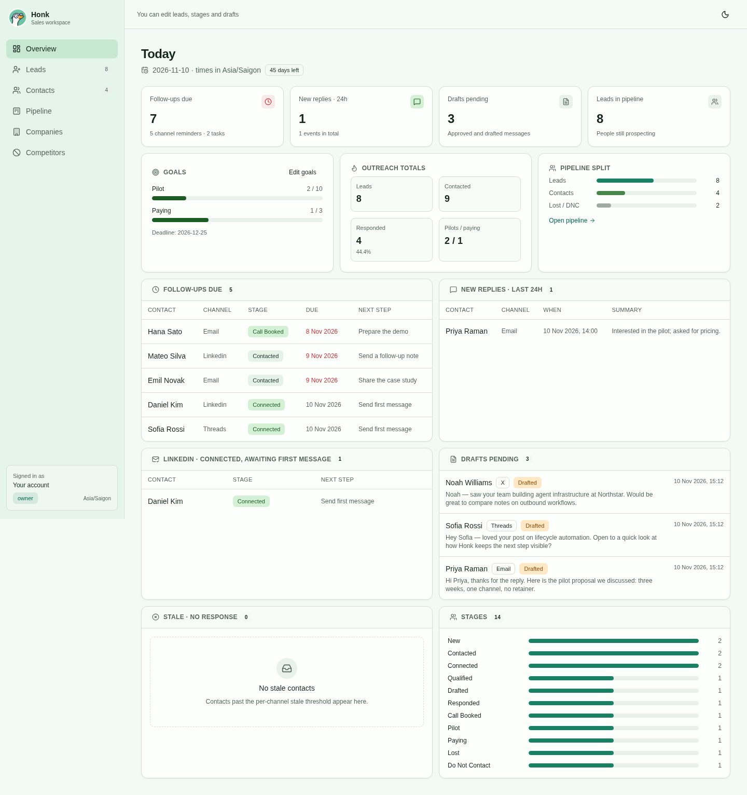
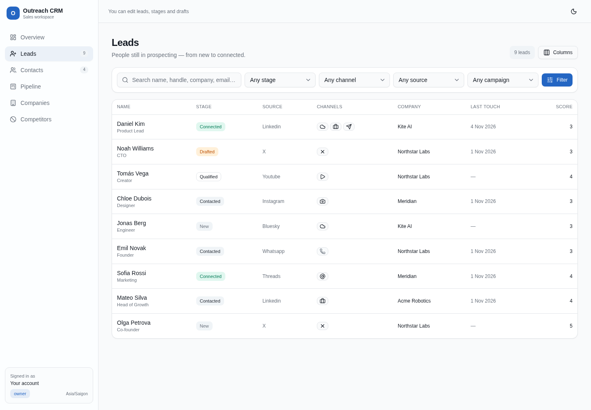
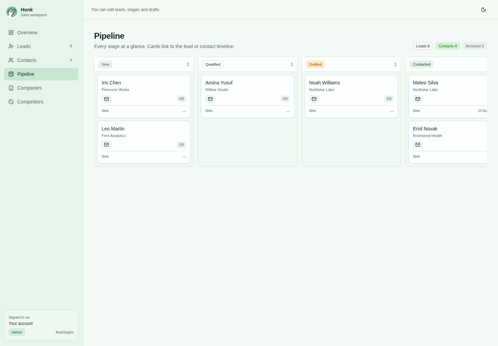
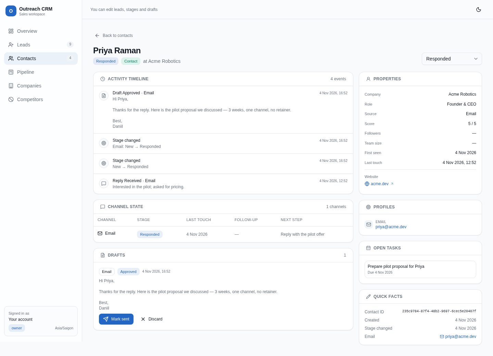
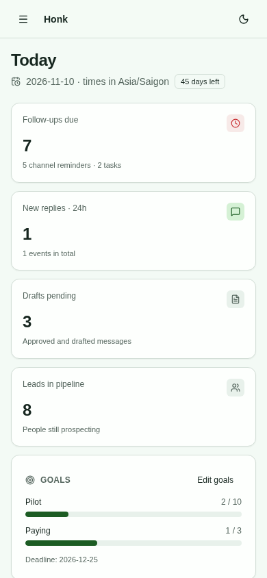

# Outreach CRM

**An agent-first CRM for outreach across channels.** Give an AI agent a shared place to find prospects, keep records up to date, track conversations, and plan follow-ups. The work stays visible to your team in a web dashboard.

The agent works through connected tools, while people review drafts, watch the pipeline, and step in where judgment is needed. Outreach CRM records what was sent; it does not send messages itself.

## What you can do

- **See what needs attention today.** Find due follow-ups, new replies, pending drafts, stale conversations, and outreach progress in one overview.
- **Keep one record per person.** Bring together profiles, company details, notes, channel activity, and conversation history. The CRM matches existing people and companies when new leads are imported.
- **Move leads through the pipeline.** Track prospects from new lead to paying customer, with a clear view of each stage and the next step.
- **Work across channels.** Track outreach on X, LinkedIn, Reddit, email, and other social or community channels. Add custom channels for your team's workflow.
- **Review outreach before it happens.** Keep message drafts, approval states, and follow-up reminders alongside the contact.
- **Coordinate a team and an agent.** Invite teammates, choose their access level, and give agents their own credentials. Activity history shows who changed a record and why.

## A typical day

1. The agent finds or imports leads, checks for existing records, and keeps each person's history together.
2. As outreach happens, the agent records touches and replies, moves stages forward, and sets follow-up reminders.
3. Open **Today** to review new replies, work due, and drafts waiting for approval. Open a lead to see its full history.
4. Check the **Pipeline** to see which relationships are moving toward a pilot or customer.

| Leads and contacts | Pipeline |
|---|---|
|  |  |

## Explore the workspace

The web dashboard has views for **Today**, **Leads**, **Contacts**, **Pipeline**, **Companies**, and **Competitors**. Each person has a detail page with their activity, channel states, drafts, and linked profiles. A mobile layout and dark mode are available too.

| Contact detail | Mobile overview |
|---|---|
|  |  |

## Getting started

This project is self-hosted. To run it locally, create your first organization, connect an agent, or deploy your own instance, follow the [setup and technical reference](docs/technical-reference.md#local-dev). The reference also covers [agent connections](docs/technical-reference.md#connecting-an-mcp-client), [CSV imports](docs/technical-reference.md#sales-outbound-setup-after-deploy), [team access](docs/technical-reference.md#architecture), and [deployment](docs/technical-reference.md#deploy).

The hosted instance at [outreach-crm.daniil-pokrovsky.workers.dev](https://outreach-crm.daniil-pokrovsky.workers.dev) requires an account or invitation.
