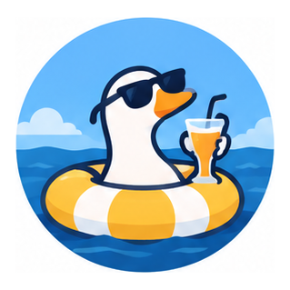

  

# Honk

**A small CRM with big goose energy.**

You have prospects. You have tabs. Somewhere, you have a very important follow-up you were absolutely going to remember.

Honk gives your team and your AI agent one place to keep leads, conversations, drafts, and next steps. The agent tends the records. You steer the relationships. A goose supervises, despite having no relevant qualifications.

The agent is Honk's primary user; humans get a dashboard to review the work and step in when needed.

## Get your ducks in a row. Hire a goose.

- **A morning briefing for your flock.** Due follow-ups, new replies, pending drafts, and stale conversations gather in **Today**. Coffee remains your responsibility.
- **One person, one record, fewer mysteries.** Keep profiles, companies, notes, and conversation history together. Imported leads are matched against existing people and companies, because three copies of the same prospect do not count as pipeline growth.
- **A pipeline with somewhere to go.** Move leads from first hello toward a pilot or paying customer. Give every promising conversation a next step before it wanders into the reeds.
- **Many channels. One nest.** Track outreach on X, LinkedIn, Reddit, email, and other social or community channels. Add custom channels when your flock takes an unusual route.
- **Drafts before dramatic entrances.** Review messages, approval states, and follow-up reminders alongside each contact. The goose may be impulsive. Your workflow needn't be.
- **Room for the whole gaggle.** Invite teammates, set access levels, and give agents their own credentials. Activity history keeps track of who changed what and why. “The goose did it” is now a testable claim.

Honk records outreach; your agent uses connected tools to actually send it. Keep that distinction in mind before asking the dashboard to honk at someone.

## A day at the pond

1. Your agent finds or imports prospects and checks whether they're already in the nest.
2. As conversations happen, it records touches and replies, updates stages, and sets follow-ups.
3. You open **Today**, review drafts and replies, and decide who needs a thoughtful hello.
4. You check **Pipeline** to see what's moving. The goose checks for bread. Different metrics.

| Leads and contacts | Pipeline |
|---|---|
|  |  |

## Take a gander

The dashboard includes **Today**, **Leads**, **Contacts**, **Pipeline**, **Companies**, and **Competitors**. Each person has a detail page with activity, channel states, drafts, and linked profiles. There's a mobile layout for pondside operations and dark mode for nocturnal honking.

| Contact detail | Mobile overview |
|---|---|
|  |  |

## Build your nest

Honk is self-hosted. Follow the [setup and technical reference](docs/technical-reference.md#local-dev) to run it locally, create your first organization, connect an agent, or deploy your own instance.

The reference also covers [agent connections](docs/technical-reference.md#connecting-an-mcp-client), [CSV imports](docs/technical-reference.md#sales-outbound-setup-after-deploy), [team access](docs/technical-reference.md#architecture), and [deployment](docs/technical-reference.md#deploy).

Already have an invitation? Waddle over to the [hosted instance](https://outreach-crm.daniil-pokrovsky.workers.dev). An account or invitation is required. Being a goose is optional.
