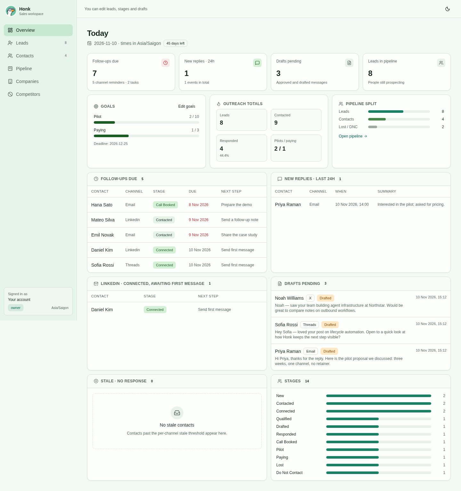
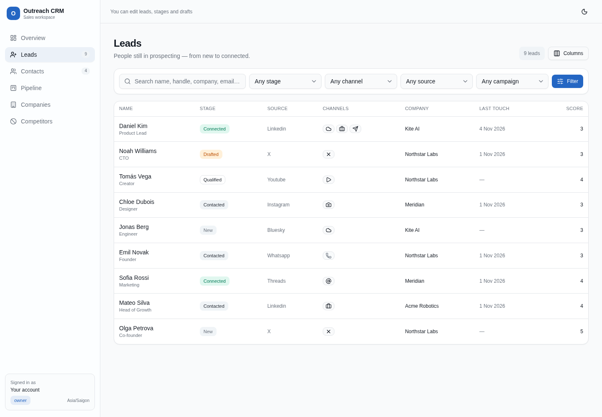
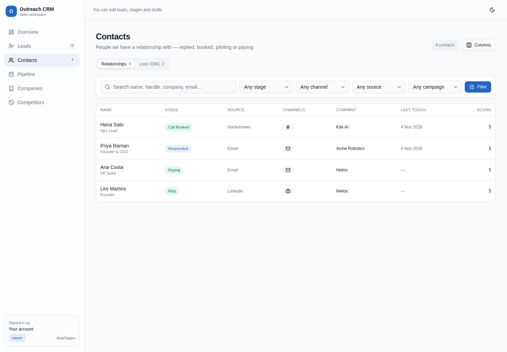
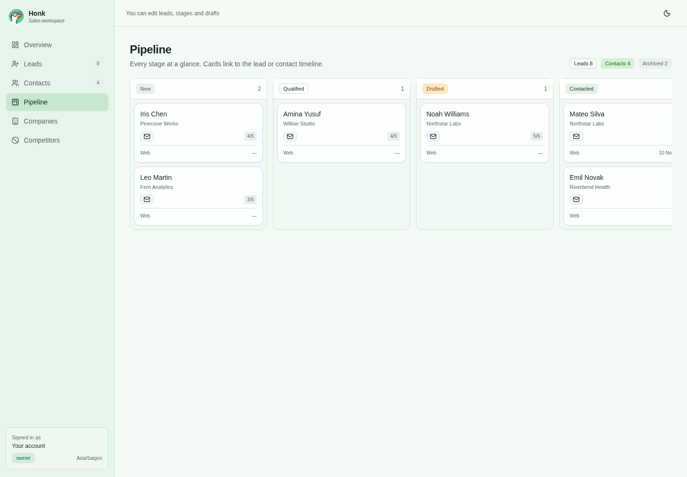
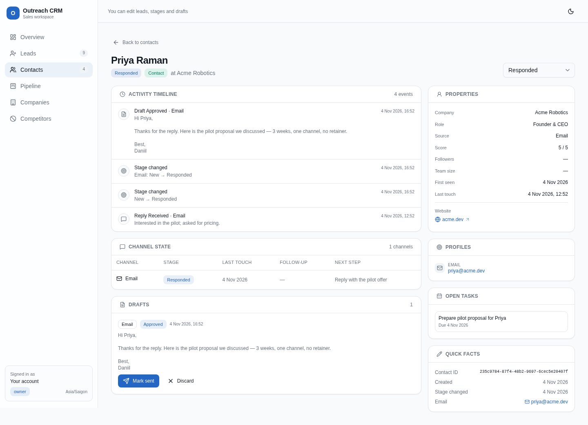
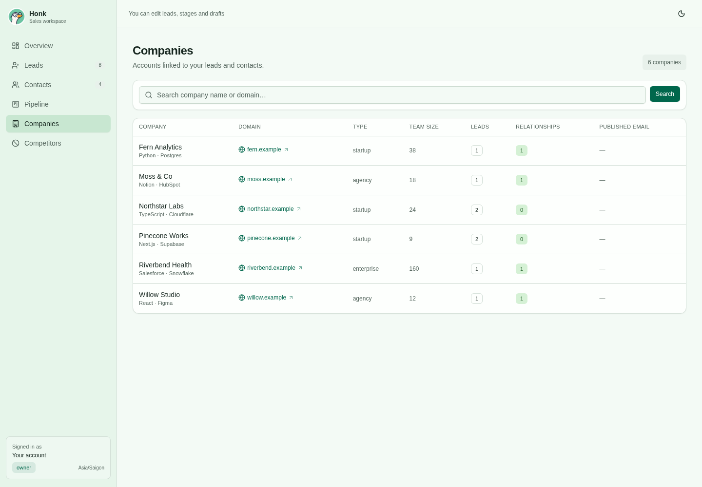
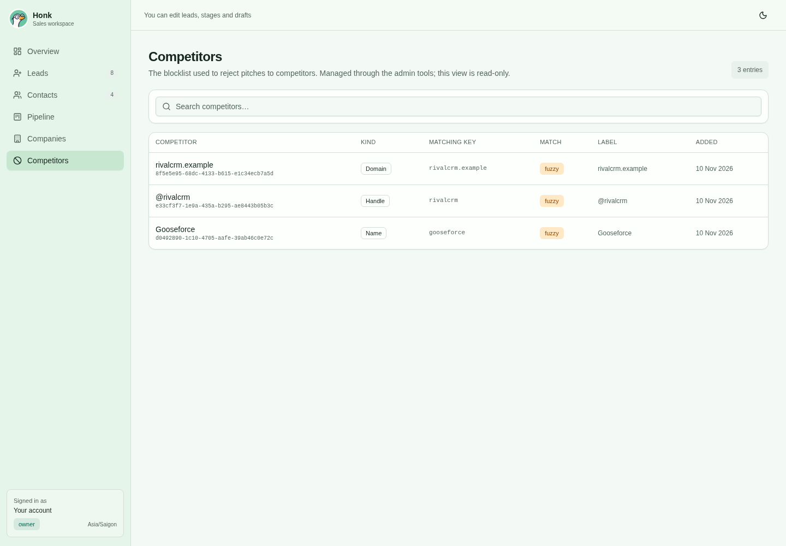
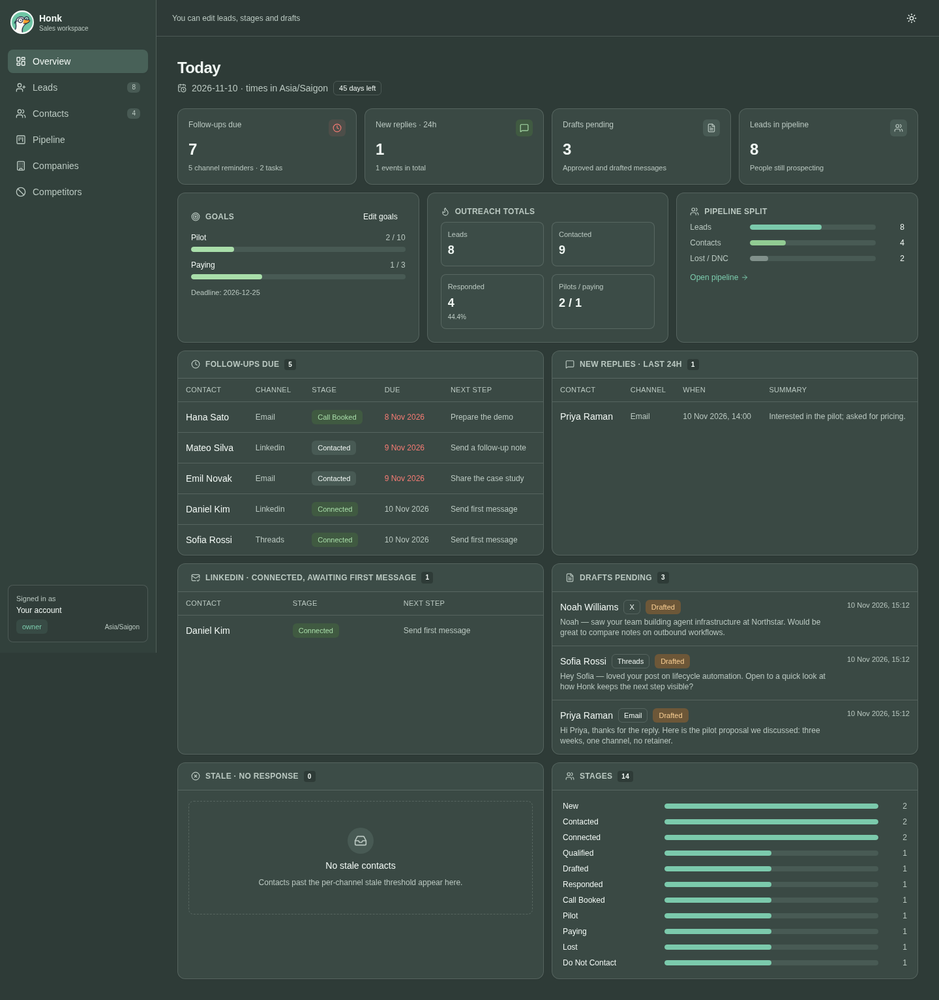

# Technical reference

For the product overview, see the [README](../README.md).

The primary agent interface is an **MCP server** (`/mcp`); a REST API (`/v1/<tool>`) exposes the same service layer.

## Stack
Workers + Hono · Cloudflare `agents` SDK (`createMcpHandler`) + `@modelcontextprotocol/server` v2 ·
D1 + Drizzle (SQL migrations in `migrations/`) · Better Auth (organization, API key, MCP/OAuth 2.1 + JWT plugins) ·
Vite + `@cloudflare/vite-plugin` · React SPA with shadcn/ui components + Tailwind CSS ·
Vitest + `@cloudflare/vitest-plugin` (runs inside workerd) · Oxlint · TypeScript · bun.

## Architecture
```
request ─► Hono (src/index.ts)
            ├─ /api/auth/*            Better Auth (sessions, orgs, API keys, OAuth2.1 AS: /oauth2/*, /jwks)
            ├─ /.well-known/*         OAuth AS + protected-resource metadata
            ├─ /sign-in, /consent     tiny HTML pages for the OAuth hop
            └─ /mcp, /v1/*  ─► resolveOrgContext (src/middleware.ts)
                                 x-api-key / Bearer ocrm_…  → org API key  → {org_id, actor: agent, scopes}
                                 Bearer <JWT> / session cookie → user   → {org_id, actor: user, role, scopes}
                               ─► callTool (src/tools.ts)       one registry for REST + MCP, central role guard
                               ─► CrmService (src/service.ts)   zod-validated tools, idempotency, activity log
                                  TeamService (src/team.ts)     members, invites, API keys, seats
                               ─► Repository (src/repository.ts) the ONLY data access; every query filtered by org_id
                               ─► D1
```
* **Tenancy:** every CRM table has `org_id` (FK → `organization`). `Repository` is constructed with an
  `OrgContext` and stamps/filters `org_id` on every statement; services never touch Drizzle directly.
* **Auth:** API keys are org-owned (`references: "organization"`, prefix `ocrm_`, default permission
  `crm:[read,write]`). OAuth access tokens are JWTs verified locally against the JWKS (issuer + audience =
  `${BETTER_AUTH_URL}/mcp`); org = `x-org-id` header or the user's only membership.
* **Activity log:** `activity_log` is append-only — the repository has no update/delete method and DB
  triggers (`migrations/0001_…`) abort UPDATE/DELETE. Every write records actor, action, entity, payload, `reason`.
* **Idempotency:** every write tool accepts `idempotency_key` (REST also accepts the `Idempotency-Key` header).
  Stored in `idempotency_keys (org_id, key)` with a hash of op+input; same key+input replays the stored
  response, same key + different input → `409 conflict`.
* **Dedupe:** contacts by normalized email, then normalized LinkedIn URL; companies by normalized domain
  (work-email domains auto-create/link a company; free-mail domains don't). Touches by `(channel, external_id)`.

* **Teams / roles** (`src/roles.ts`): `owner > admin > member > viewer` on top of Better Auth's organization
  plugin (same access-control roles are configured there, so `/api/auth/organization/*` follows them too).
  Effective scopes = credential scopes ∩ role scopes (viewer ⇒ `crm:read` only). Users get their membership role;
  API keys carry `metadata.role` (default `member`; keys created before roles existed count as `member`).
  | | viewer | member | admin | owner |
  |---|---|---|---|---|
  | read CRM, `get_org_usage`, `list_members` | ✓ | ✓ | ✓ | ✓ |
  | CRM writes (contacts, touches, drafts, tasks, imports) | | ✓ | ✓ | ✓ |
  | blocklist (`add/update/remove/purge_competitor(s)`), `upsert_campaign`, members, invites, API keys | | | ✓ | ✓ |
  | `transfer_ownership`, `set_seat_limit`, `delete_org` | | | | ✓ |

  Admins can't grant above their own role, touch owners, or grant owner. The last owner can't be removed or demoted.
* **Seats:** seats = human members (API keys/bots never count). `organization.seat_limit` (null = unlimited) is
  enforced on `accept_invite` and in Better Auth's `beforeAddMember` hook. `get_org_usage` reports seats, keys, contacts.
* **Invitations:** `invite_member` returns `accept_url` = `/accept-invite?token=<invitation id>` and never emails.
  Delivery goes through `setInviteSender()` (`src/invites.ts`; default logs invitation metadata). The invitee signs in and
  accepts on that page (→ `POST /invites/accept`, session or OAuth bearer) or calls `accept_invite` over MCP/REST.
  The invitee's email must match. Invites expire after 7 days; re-inviting cancels the old one.
* **Multiple orgs:** a user can belong to many orgs. Org = `x-org-id` header, else the session's active org, else the
  only membership. `switch_org` persists the active org on cookie sessions; `list_my_orgs` shows all.

### Tools (MCP and `POST /v1/<tool>`)
Every write tool accepts `idempotency_key` (MCP) or an `Idempotency-Key` header (REST). Reusing a key with
different input returns `conflict`. The CRM **never sends anything**; it records what you sent.

| Area | Tools |
|---|---|
| Contacts and companies | `search_contacts`, `get_contact`, `upsert_contact`, `upsert_company`, `find_existing`, `list_contacts`, `list_contacts_view`, `list_companies`, `add_note`, `get_activity` |
| Channel state and reminders | `set_channel_state`, `log_touch`, `update_stage`, `due_followups`, `stale_no_response`, `linkedin_needs_first_message`, `list_due_followups`, `create_task`, `complete_task` |
| Competitors | `is_competitor`, `add_competitor` (`match: exact\|fuzzy`), `update_competitor` (`value` / `match` / `label`), `remove_competitor`, `purge_competitors` (ids / `value_regex`, `dry_run` defaults to true), `list_competitors` |
| Drafts and campaigns | `create_draft`, `transition_draft`, `list_drafts`, `upsert_campaign`, `list_campaigns` |
| Pacing and reporting | `x_pacing_today`, `outreach_report`, `pipeline_summary` |
| CSV | `import_leads_csv` (dry run by default), `export_csv` |
| Org and usage | `get_org_usage`, `list_my_orgs`, `switch_org`, `set_seat_limit` (owner), `delete_org` (owner, `confirm_slug`) |
| Members | `list_members`, `update_member_role`, `remove_member`, `transfer_ownership` (owner) |
| Invites | `invite_member`, `list_invites`, `revoke_invite`, `accept_invite` (user only) |
| API keys | `create_api_key` (role, default member; secret shown once), `list_api_keys`, `revoke_api_key` |

Also `GET /v1/me`.

### Web UI (`/dashboard`)

The dashboard is a React SPA (shadcn/ui components + Tailwind, built by Vite and served by the Worker's static
assets binding). Every page is still behind the Better Auth session: `/dashboard/*` runs the same
`resolveOrgContext` check and redirects anonymous visitors to `/sign-in?next=…`. The UI only calls the REST
API (`/v1/<tool>`, `/v1/overview`) and never touches D1 directly.

| Page | What it shows |
|---|---|
| Overview | Today's follow-ups and tasks, new replies, LinkedIn connections awaiting a first message, pending drafts, X pacing, stale contacts, goal progress and stage counts |
| Leads | People still prospecting (`new … connected`), with search, stage/channel/source/campaign filters, a column chooser, Add person, and CSV import with a dry-run preview |
| Contacts | Relationship stages (`responded … paying`) plus a Lost / DNC tab and Add person |
| Pipeline | Kanban board by stage, with links into every lead/contact |
| Lead / contact detail | Edit profile; add notes and tasks; log touches and replies; create/edit/transition drafts; edit per-channel stage and follow-up; complete tasks; activity timeline and linked profiles |
| Companies | Add/edit accounts with domain links and lead/relationship counts |
| Competitors | Admin add/edit/remove blocklist entries |
| Workspace | Admin campaign, custom channel, and follow-up rule forms |

Lead vs contact is derived from the stage (no duplicate lifecycle column): `lead` = new, qualified, drafted,
contacted, connection_pending, connected; `contact` = responded, call_booked, pilot, paying; `archived` =
lost, do_not_contact. `list_contacts` accepts an optional `lifecycle` filter and `list_contacts_view` returns
the split counts plus linked identities. The UI is read-only for viewers; stage changes and draft transitions
and forms are only shown when the session role has `crm:write`; admin forms require an admin role.

Human forms call the same REST tools as MCP agents: `upsert_contact`, `upsert_company`, `add_note`,
`create_task`, `complete_task`, `log_touch`, `record_event`, `set_channel_state`, `update_stage`,
`create_draft`, `transition_draft`, `upsert_campaign`, `add_custom_channel`, `set_followup_rules`,
`add_competitor`, `update_competitor`, `remove_competitor`, `set_goals`, and `import_leads_csv`.
Integration and bulk operations such as `sync_sent`, `mark_draft_sent`, `bulk_update_stage`, and
`purge_competitors` remain available through MCP/REST.

Every identity in the UI is an outbound link built from the channel registry (`src/channels.ts`): X, LinkedIn,
Reddit, GitHub, Threads, email (`mailto:`), Hacker News, Bluesky, Telegram, YouTube and custom channels.
WhatsApp numbers stay masked and are never linked unless an admin requests private identities.

### Screenshots

| | |
|---|---|
|  |  |
|  |  |
|  |  |
|  |  |

These images use fictional data. To recreate the isolated local database, run
`bun scripts/prepare-screenshots.ts --reset`, start `bunx vite --config vite.screenshots.config.ts`,
then run `bun scripts/seed-screenshots.ts` in another terminal. The fixture creates 14 contacts,
six companies, and example activity. Its temporary login is saved under `.wrangler/screenshot-config/`
(ignored by Git). Capture the pages at `http://localhost:5174/dashboard`.

**Identities:** email, x_handle, linkedin_url, reddit_user and github are normalized (lowercase, URL and `@`/`u/`
prefixes stripped) and unique per org. Company domain is unique per org.
## Channels

Channels and identities are config-driven (`src/channels.ts`); adding a channel needs no migration. Every identity lives in
`contact_identities` (unique per org + kind + scope + value), which drives dedupe, `find_existing`, `find_by_identity`,
`is_competitor` and imports. The legacy contact columns (`email`, `x`, `linkedin`, `reddit_user`, `github`,
`threads_handle`) stay and are kept in sync, so the old tool args still work. Use `identities: [{kind, value, scope?}]` on
`upsert_contact` / `find_existing` / `record_event` for anything else.

| Channel | Identity kind | Profile URL parsed | Import prefix | Follow-up / stale days |
|---|---|---|---|---|
| x | `x_handle` | x.com/, twitter.com/ | `x:`, `twitter:` | 3 / 6 |
| linkedin | `linkedin_url` | linkedin.com/in/ | `li:`, `linkedin:` | 5 / 10 |
| reddit | `reddit_user` | reddit.com/user/, u/ | `rd:`, `reddit:` | 4 / 8 |
| email | `email` | mailto: | `email:`, `mailto:` | 4 / 8 |
| threads | `threads_handle` | threads.net/@, threads.com/@ | `threads:`, `th:` | 3 / 6 |
| hackernews | `hn_user` | news.ycombinator.com/user?id= | `hn:` | 4 / 8 |
| github | `github` | github.com/ | `gh:`, `github:` | 5 / 10 |
| discord | `discord_user` + server scope | discord.com/users/ | `discord:` | 3 / 7 |
| slack_community | `slack_user` + workspace scope | `<ws>`.slack.com/team/U… | `slack:` | 3 / 7 |
| bluesky | `bsky_handle` | bsky.app/profile/ | `bsky:`, `bluesky:` | 3 / 6 |
| tiktok | `tiktok` | tiktok.com/@ | `tiktok:`, `tt:` | 4 / 8 |
| instagram | `instagram` | instagram.com/ | `ig:`, `instagram:` | 3 / 6 |
| youtube | `youtube` | youtube.com/@, youtube.com/channel/ | `yt:`, `youtube:` | 5 / 10 |
| facebook | `facebook` | facebook.com/, profile.php?id= | `fb:`, `facebook:` | 4 / 8 |
| telegram | `telegram` | t.me/ | `tg:`, `telegram:` | 3 / 6 |
| whatsapp (private) | `whatsapp` (E.164) | wa.me/ | `wa:`, `whatsapp:` | 3 / 6 |

Sources and channels are validated against the registry (builtins + org custom channels). **WhatsApp is private**: numbers are masked in
`get_contact`, `export_csv` (the `identities` column), `find_by_identity` and everywhere else. The only exception is an admin
passing `include_private: true` to `get_contact` or `export_csv`. **Custom channels:** admins call `add_custom_channel`
(`id, label, url_pattern` with `{handle}`, `prefix, followup_days, stale_days`). The channel then works at runtime in
identities, imports, channel states and follow-ups. `list_channels` shows the registry, and per-org follow-up overrides
still come from `set_followup_rules`.

**Stages** (overall and per channel x/linkedin/reddit/email): `new, qualified, drafted, contacted,
connection_pending, connected, responded, call_booked, pilot, paying, lost, do_not_contact`. The dashboard groups
these into **leads** (through `connected`), **contacts** (`responded` onward) and **archived** (`lost`,
`do_not_contact`). Automatic moves are
forward only; `do_not_contact` is sticky. The overall stage is the furthest channel stage. Explicit
`set_channel_state` / `update_stage` set exactly. **Drafts:** `drafted → approved → sent`, and either one can go to
`discarded` or back to `drafted` (to edit). Marking `sent` logs the touch, sets the channel to `contacted` and an optional
follow-up. **Reminders** are the per-channel `next_followup_at`, read through `due_followups` (tz defaults to Asia/Saigon).
**X pacing:** the default check uses at least 60 minutes between sends and at most 8 per local day (`x_pacing_today`). **Goals:** admins can set stage targets and an optional deadline with `set_goals`; unconfigured organizations have no goal progress. `outreach_report` and the dashboard show the configured targets.
Migration 0002 maps v1 stages: replied→responded, meeting→call_booked, won→paying.

### Competitor matching
Name entries keep the full name as given in `display_name` (e.g. `Orchestrator.inc`, `Concord AI`) and a
normalized key in `value` (`orchestrator inc`, `concord ai`); legal suffixes (Inc/Ltd/LLC/GmbH/Labs/AI/IO...)
are only ignored at match time. `match: exact` hits when a lead's person name OR company name equals the
full name (suffixes ignored on both sides: `Station Labs Ltd` = `Station`; `John Station` never matches).
`match: fuzzy` adds the full key as whole words inside a company name (`concord ai` matches `Concord AI
Platform`, never `Concord Health`). Single words of up to 7 characters default to `exact`; pass `match` to
override, or change it later with `update_competitor` (admin; also restores a full name via `value`). Handles and
domains always match exactly (domains include subdomains). `u/name`, `/u/name` and `reddit.com/user/name`
are Reddit handles, never names or X handles.

### CSV import normalization
- `source` is mapped case-insensitively: `reddit*`/`prowlo*`/`*reddit*` -> reddit, `email*` -> email,
  `linkedin*` -> linkedin, `x_*`/`twitter*` -> x, `handoff_*`/`web*` -> web. The raw value is kept in `source_detail`.
- `est_team_size`: numbers as-is, ranges like `5-10` -> midpoint (8); anything else is stored in `est_team_size_text` without warnings.
- `score` above 5 (up to 10) is treated as a 1-10 scale: `max(1, round(score/2))`; the original goes to `score_original`
  and the report has one summary line in `notices`.
- `status: warm` -> responded. A `stage` column is accepted as an alias of `status`.
- Identity comes from `profile_url` first. A non-social `profile_url` (not x/twitter/linkedin/reddit/github) is stored as
  `website` and its domain becomes the company domain; a bare `handle` next to it is NOT treated as an X handle
  (use `@name` or `x:name` to force X). The raw `profile_url` is stored and exported verbatim.
- Ambiguous sources (`web`, `handoff_*`, missing/unknown) follow a social `profile_url` (x / linkedin / reddit).
- Handle prefixes: `li:<slug>` (LinkedIn /in/), `x:`/`twitter:`, `gh:`/`github:`, `reddit:`/`u/`.
- `export_csv` exports the raw `profile_url` (pass `derived_profile_url: true` for URLs rebuilt from identities),
  the stage as `stage`, plus `website`, `source_detail` and a `status` alias column at the end.
- `upsert_contact` accepts `contact_id` (edit that exact contact), `profile_url`, `website`, `source_detail`, and
  `clear: [x_handle|linkedin_url|reddit_user|github|email|profile_url|website|company_id]` to null fields.

### Calling the REST API: send a custom User-Agent
Callers should always send a descriptive `User-Agent` (e.g. `sales-outbound/1.0`). Generic library agents such as
`python-requests/*` can be challenged or blocked with a 403 at Cloudflare's edge (Bot Fight Mode / browser-integrity
heuristics, which also weigh the caller's IP reputation) before the request reaches the Worker. Edge blocks return a
Cloudflare HTML page; the CRM's own 401/403 errors are always JSON. Account-wide security settings are deliberately unchanged.

```python
requests.post(f"{BASE}/v1/list_competitors", json={}, headers={"Authorization": f"Bearer {KEY}", "User-Agent": "sales-outbound/1.0"})
```

## Local dev
```bash
bun install
cp .dev.vars.example .dev.vars          # set BETTER_AUTH_SECRET (≥32 random chars)
bun run dev                             # applies local D1 migrations, then starts http://localhost:5173
```
Create a user + org + org API key (prints the key once):
```bash
bun scripts/bootstrap.ts --email me@example.com --password 'a-long-password' --org "Acme"
curl -s localhost:5173/v1/pipeline_summary -X POST -H "x-api-key: ocrm_…" -d '{}'
```

## Connecting an MCP client
* **Headless agent (API key):** Streamable HTTP at `http://localhost:5173/mcp` with header
  `Authorization: Bearer ocrm_…` (or `x-api-key`). e.g. Claude Code:
  `claude mcp add --transport http crm http://localhost:5173/mcp --header "Authorization: Bearer ocrm_…"`
* **Interactive (OAuth):** point the client at `http://localhost:5173/mcp` with no header. It gets a 401 with
  `WWW-Authenticate: Bearer resource_metadata=…`, discovers the AS, registers via DCR, sends you to `/sign-in`
  then `/consent`, and receives a JWT scoped to `crm:read crm:write`. Multi-org users must send `x-org-id`.

### Sales Outbound setup (after deploy)
1. Create the org and an **admin** API key once: `bun scripts/bootstrap.ts --url https://<crm-host> --email … --password … --org "Sales"`
   (`--role member` for a narrower key). Keep the printed `ocrm_…` key in the agent's secret store. An admin key is
   needed for `add_competitor`/`remove_competitor`/`upsert_campaign`; keys created before roles existed act as `member`
   — replace them with `create_api_key {role:"admin"}`.
2. MCP config (Streamable HTTP):
   ```json
   { "mcpServers": { "crm": { "type": "http", "url": "https://<crm-host>/mcp",
     "headers": { "Authorization": "Bearer ocrm_…" } } } }
   ```
   or `claude mcp add --transport http crm https://<crm-host>/mcp --header "Authorization: Bearer ocrm_…"`.
3. Seed the competitor blocklist with `add_competitor` for each name, handle and domain.
4. Import the existing sheet. Export it as CSV with the columns `handle,name,profile_url,bio_summary,followers,company,role,
   est_team_size,signal_post_url,signal_post_date,signal_summary,score,source,status,first_seen,notes`, then:
   ```bash
   CRM_URL=https://<crm-host> CRM_API_KEY=ocrm_… bun scripts/import-leads.ts leads.csv           # dry-run report
   CRM_URL=https://<crm-host> CRM_API_KEY=ocrm_… bun scripts/import-leads.ts leads.csv --commit  # write
   ```
   You can also call `import_leads_csv` over MCP with `{csv, dry_run:true}`, then `dry_run:false`. Re-runs are
   idempotent: existing contacts are matched on any identity, stages never go backwards, and identities and notes
   only fill blanks. Unknown `status` values become `new` and are listed in the report.

## Checks
```bash
bun run typecheck && bun run lint && bun run test
```
Tests run in workerd with migrations applied: tenant isolation, scopes, dedupe, idempotency (replay,
conflict, per-org), activity log (coverage, no rows on replay, DB-level immutability), and HTTP
(API key → REST/MCP, 401 challenge, OAuth metadata).

## Schema changes
Edit `src/db/schema.ts` → `bun run db:generate` → `bun run db:migrate:local`. Better Auth tables live in
`src/db/auth-schema.ts`, regenerate with `bunx auth@latest generate --config auth.cli.ts --output src/db/auth-schema.ts --yes`.

## Deploy
Live: **https://outreach-crm.daniil-pokrovsky.workers.dev** (D1 `outreach-crm`, id in `wrangler.jsonc`;
`BETTER_AUTH_URL` var = that URL; `BETTER_AUTH_SECRET` is a Worker secret; local dev overrides the URL in `.dev.vars`).
```bash
bunx wrangler d1 migrations apply outreach-crm --remote
bun run deploy
```

### Sign-up guard (`ALLOWED_SIGNUP_EMAILS`)
Comma-separated emails or `@domain` entries (`*` = open sign-up). When unset (the default): the **first** account
(the bootstrap owner) may sign up, after that only emails with a pending invite. When set, the first-user exception is off: only listed emails or invitees. Set it with
`bunx wrangler secret put ALLOWED_SIGNUP_EMAILS` (or as a var) to pin the first owner before bootstrapping.

### First owner
```bash
bun scripts/bootstrap.ts --url https://outreach-crm.daniil-pokrovsky.workers.dev --email <you> --password '<long>' --org "Sales"
```
Signs up (first user), creates the org (you = owner) and prints an admin `ocrm_…` key. Everyone else: `invite_member`.
